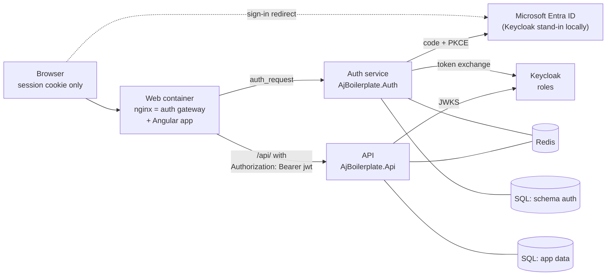
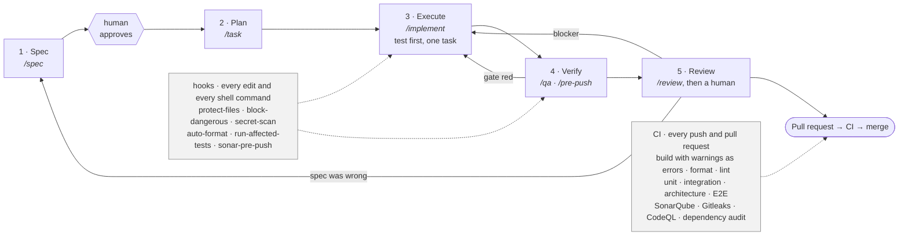

<div align="center">


# Agentic Full-Stack Boilerplate

**A .NET 10 + Angular 21 starting point that ships with its own engineering guardrails.**

[](https://dotnet.microsoft.com/)
[](https://angular.dev/)
[](https://nx.dev/)
[](https://primeng.org/)
[](https://learn.microsoft.com/ef/core/)
[](#licence)

</div>

---

## What this is

A starting point for a new product, with the hard parts already working:

1. **A .NET 10 API** (layered Clean Architecture, EF Core, SQL Server) and an **Angular 21 web app**
   (Nx, PrimeNG), joined by an OpenAPI contract that generates the frontend's types.
2. **Sign-in that keeps tokens out of the browser**: Microsoft Entra ID through a small Auth
   service, roles from Keycloak, nginx as the gateway. It runs locally with no Microsoft tenant.
3. **A quality gate and an agentic harness** (`.claude/`) that enforce the rules instead of
   describing them.

It contains **no business domain**. The sample `Item` is meant to be deleted on day one. The
["What's new"](docs/whats-new.md) spotlight is not a sample; it is domain-free plumbing worth
keeping. What it is **not**: a platform, a CMS, or a deployment you can apply as-is. `infra/`
ships reviewed IaC with no state and no real project identifiers (see
[what is deployed](docs/auth/setup.md#what-is-not-deployed)).

## Quickstart (about 5 minutes)

**Prerequisites:** Docker (Compose v2). That is all you need to run it.
To build or test outside Docker you also need the **.NET SDK 10** (pinned in
`src/backend/global.json`, `10.0.100`, newer feature bands accepted) and **Node.js 22** with npm 10+
(`src/frontend/.nvmrc`, `engines` allows `>=22 <23`).

```bash
git clone https://github.com/<your-org>/aj-boilerplate-fs.git
cd aj-boilerplate-fs

cp .env.example .env          # then set MSSQL_SA_PASSWORD (any strong value; nothing else is required)
docker compose up --build
```

The first run builds images and imports the Keycloak realm, so allow a few minutes. Then open
**<http://localhost:4200>**.

**Sign in** with one of the seeded local users. All five share the committed, dev-only password
`dev-only-password-never-reuse` (`LOCAL_USER_PASSWORD` in `docker-compose.yml`; override it in
`.env`). These accounts exist only inside your local Keycloak container:

| Username | Can do | What you should see |
|---|---|---|
| `admin` | everything | The app, with **Items**, **New Item**, edit and delete, and under **Administration** **Users & roles** and **Sign-in history** |
| `editor` | create and edit | The app, no delete, no Administration (`editor2` is a second editor) |
| `viewer` | read | The app, read-only; no **New Item** |
| `noaccess` | nothing | Keycloak accepts the login, then a **403 "No access"** page |

You land on the home page. As `admin`, open **Users & roles** to see who holds which seat, add a person
(an `example.com` address; the local stack allows only that domain), move someone between seats, or
disable them. Disabling ends their session immediately; a seat change reaches an open session within the 15 s
roles-version poll. **Sign-in history** lists every session and,
once a session has ended, how (logged out, expired, or signed out by the system). The top bar's portal
switcher lists the two sample portals from the `Portals__*` settings in `docker-compose.yml`. Open
**Items** and create, edit and (as `admin`) delete a row. That
round trip exercises the sign-in, the gateway, the generated types, the controller, the handler,
the repository and the migration. Seeing it work now means that when something breaks later, you
know it was you.

| | |
|---|---|
| Web app (the only URL a browser should use) | <http://localhost:4200> |
| API (needs a session; a direct browser call answers 401) | <http://localhost:8080> |
| Readiness probe | <http://localhost:8080/health/ready> |
| Keycloak admin console (dev-only credentials in `docker-compose.yml`) | <http://localhost:8081> |

```bash
docker compose down       # stop, keep the database volume
docker compose down -v    # stop and destroy local data (also the fix for a stale volume)
```

Port taken? Set `WEB_PORT`, `API_PORT`, `KEYCLOAK_PORT`, `DB_PORT` or `REDIS_PORT` in `.env`.
`.env.example` lists every variable the repository reads.

**No Docker, UI work only:** `cd src/frontend && npm ci && npm run dev:offline` serves the app
against in-browser mocks with a role picker.

**Before you change anything**, prove the gate is green on your machine:

```bash
dotnet build src/backend/AjBoilerplate.slnx -warnaserror
dotnet test  src/backend/tests/AjBoilerplate.UnitTests
cd src/frontend && npx nx affected -t lint,test,build
```

The full command reference is in [CLAUDE.md](CLAUDE.md). The first-day checklist is
[docs/onboarding.md](docs/onboarding.md).

## Architecture



- **Web container**: serves the SPA and is the gateway. It checks the cookie with the Auth service
  on every request and gives the API a JWT. The browser never sees the JWT.
- **Auth service**: signs users in against Entra ID, exchanges the result at Keycloak, keeps the
  sessions (SQL system of record, Redis in front).
- **API**: validates the Keycloak JWT and enforces roles with policies. Knows nothing about Entra.
- **Keycloak**: where roles live. **Entra ID**: proves who the person is.

## How auth works, on one screen

1. You open the app. nginx asks the Auth service if your cookie is a live session. It is not, so you
   are sent to `/login`, and the app starts sign-in at `/auth/login`.
2. The Auth service sends you to Entra ID. You sign in there. Entra sends you back with a code.
3. The Auth service redeems the code, exchanges the Entra token at Keycloak for a **JWT for this
   application**, stores both encrypted, and sets one `HttpOnly` cookie.
4. From then on nginx turns the cookie into `Authorization: Bearer <jwt>` for `/api/` calls. The
   API checks the JWT and the user's roles.
5. The Auth service renews the JWT in the background. Sessions end after 8 h idle or 12 h from
   sign-in. A Keycloak or Redis outage gives a 503, never a sign-out.

Two switches: `AUTH_PROVIDER=embedded` (default; you run the Auth service) or `usp` (inside the
Al Jazeera USP platform; the shared gateway does the job and you do not deploy the Auth service),
and `AUTH_MODE=gateway|dev` (`dev` is a role picker for UI work only).

Go deeper: [docs/auth/](docs/auth/README.md) · [setup](docs/auth/setup.md) ·
[troubleshooting](docs/auth/troubleshooting.md) · [contract](docs/auth/gateway-contract.md) ·
[why](docs/adr/0012-gateway-session-auth.md).

## What you get

- **Layered Clean Architecture backend**: `Domain` → `Application` → `Contracts` →
  `Infrastructure` → `Api`, with architecture tests that fail the build when the dependency
  direction is violated. The Auth service is a separate project that must stay independent of them.
- **A consistent API envelope**: every response is `ApiResponse<T>` with a stable `code` and a
  `traceId`. Exceptions map to responses through a handler chain.
- **OpenAPI as the contract**: the frontend's types are *generated* from `docs/api/openapi.json`.
  Hand-written DTOs on the client are a bug. See [docs/api/](docs/api/).
- **Angular 21 + Nx + PrimeNG**: standalone components, signals, `OnPush`, strict TypeScript, and
  library boundaries enforced by Nx tags.
- **Gateway session authentication** with seats (`admin`, `editor`, `viewer`) and permissions
  (`items:read`, ...), a role-change watcher, and an access-revoked dialog.
- **User administration**: a **Users & roles** page (members, search, add, change seats, disable and
  enable) over the Auth service's `/internal/admin/*` and Keycloak's Admin REST API, restricted to the
  groups under a managed path and to an allow-list of e-mail domains for new accounts.
- **Sign-in history**: every session, with how it ended, reported by the Auth service to the API
  through a transactional outbox ([session-ended contract](docs/auth/session-ended-contract.md)).
- **A portal switcher** fed by `GET /api/v1/me/portals`, and the Auth service's cross-portal
  [hand-off](docs/auth/handoff.md), `/auth/no-access` page and Pub/Sub `/auth/events` push (all
  off, or inert, until configured).
- **One pagination standard** (count left, pages middle, Rows right; 20 by default; 10/20/50/100;
  remembered per table) on every paged list.
- **A "What's new" feature spotlight**: shows each user a new feature once, acknowledged
  server-side. See [docs/whats-new.md](docs/whats-new.md).
- **Two clouds, one switch**: `CLOUD_PROVIDER=gcp|azure` selects the secrets provider and which
  `infra/` tree deploys (Terraform for GCP, Bicep for Azure).
- **A real quality gate**: warnings as errors, format check, ESLint, unit, integration and
  architecture tests, Playwright, SonarQube, Gitleaks, CodeQL, dependency and image scanning.
- **The agentic harness**: hooks and the `/spec`, `/task`, `/implement`, `/qa`, `/review`,
  `/pre-push`, `/quality-gate`, `/new-migration` and `/sync` commands, all committed.
- **A written process**: [workflow](docs/workflow.md), [Definition of Done](docs/definition-of-done.md),
  [architecture guide](docs/architecture.md), [onboarding](docs/onboarding.md).

## Repository map

```
.
├── README.md · CLAUDE.md · CONTRIBUTING.md · CHANGELOG.md · SECURITY.md   start here
├── docker-compose.yml     the whole stack: db, redis, keycloak, migrate, auth-migrate, auth, api, web
├── .env.example           every environment variable, what it does, whether it is required
├── src/
│   ├── backend/           .NET 10 solution
│   │   ├── src/           Domain · Application · Contracts · Infrastructure · Api · Auth
│   │   └── tests/         Unit · Integration · Architecture · Auth.Tests
│   └── frontend/          Nx workspace
│       ├── apps/          web (the SPA), web-e2e (Playwright + accessibility)
│       ├── libs/          auth · data-access · shared · shell · feature-items (sample)
│       └── docker/        nginx gateway profiles and container start-up scripts
├── docs/
│   ├── auth/              how sign-in works, setup, troubleshooting, the contract
│   ├── adr/               architecture decision records
│   ├── api/               how the OpenAPI contract is produced and consumed
│   ├── specs/ · incidents/ · handoff/
│   └── architecture.md · onboarding.md · workflow.md · upgrading.md · definition-of-done.md
├── infra/
│   ├── keycloak/          the DEV-ONLY realm the local stack imports
│   ├── gcp/               Terraform: Cloud Run (API), Cloud SQL, Memorystore, Secret Manager
│   └── azure/             Bicep: Container Apps (API), Azure SQL, Cache for Redis, Key Vault
├── .claude/               agents, commands, hooks, standards, templates
├── .github/workflows/     backend-ci · frontend-ci · supply-chain · deploy
└── scripts/               derive.sh (builds the single-stack repositories) · generate-openapi
```

## Common tasks

### Add an endpoint with a policy

Every controller declares who may call it. Copy `ItemsController`.

```csharp
[ApiController]
[Authorize(Policy = Policies.ReadAccess)]          // the class default: any seat, or items:read
[Route("api/v1/widgets")]
public sealed class WidgetsController : ControllerBase
{
    [HttpGet] public async Task<IActionResult> List(...) { ... }

    [HttpPost]
    [Authorize(Policy = Policies.WriteAccess)]     // narrower: editor, admin, or items:write
    public async Task<IActionResult> Create(...) { ... }
}
```

A controller with no `[Authorize]` and no `[AllowAnonymous]` fails an architecture test, and the
API's fallback policy denies anything that slips through. Then run
`./scripts/generate-openapi.sh` and `npm run generate:api` (or `/sync`) so the contract and
the frontend types follow.

### Add a permission

Add the Keycloak client role, add it to `Permissions` and `Permissions.All`, give it a policy,
and map it in `libs/auth/src/lib/roles.ts`. The six steps are in
[docs/auth/setup.md](docs/auth/setup.md#4-roles-and-permissions-end-to-end).

### Add a page with a capability guard

```ts
// apps/web/src/app/app.routes.ts, inside the authGuard group
{
  path: 'widgets/new',
  loadComponent: () => import('@aj-boilerplate/feature-widgets').then((m) => m.WidgetFormPage),
  canActivate: [capabilityGuard('canCreate')],
},
```

Add a nav entry with `requiredCapability: 'canCreate'` in `libs/shell/src/lib/nav-config.ts`. The
guard is a UX convenience; the API's policy is the real control. `libs/feature-items` is the worked
example.

### Add a migration

Prefer the `/new-migration` command. It reviews the generated SQL before anything is applied.
The rules (expand, migrate, contract) are in [src/backend/README.md](src/backend/README.md).

## Troubleshooting

| Symptom | Likely cause and fix |
|---|---|
| `docker compose up` stalls at `db`, or `db` is unhealthy | **Stale SQL volume** from an older checkout with another `sa` password. `docker compose down -v` and start again. |
| "port is already allocated" | Set `WEB_PORT`, `API_PORT`, `KEYCLOAK_PORT`, `DB_PORT` or `REDIS_PORT` in `.env`. Do not run the per-stack compose files alongside the root one. |
| `auth`/`api` waiting a long time | Keycloak is still starting (first run imports the realm). `docker compose logs keycloak`. |
| Redirected to `/login` in a loop, or no session cookie | Open **`http://localhost:4200`**, not `127.0.0.1`. Locally the cookie is `app_sid` over plain http; see [troubleshooting](docs/auth/troubleshooting.md). |
| Signed in, then every API call is 401 | The API's `Keycloak__ClientId` must equal the Auth service's `Auth__Portal__ClientId`. |
| "No access" page for everyone | The user has no role on the app's Keycloak client, or the client id is wrong. |

More in [docs/auth/troubleshooting.md](docs/auth/troubleshooting.md).

## Making it yours

1. **Rename .NET.** `AjBoilerplate` everywhere: the six project folders under `src/backend/src/`
   (including `AjBoilerplate.Auth`), the four under `src/backend/tests/`, `AjBoilerplate.slnx`,
   namespaces, `RootNamespace`/`AssemblyName`, the `sonar.projectKey`, and the Auth service's
   Dockerfile paths in `docker-compose.yml`.
2. **Rename Nx.** The `@aj-boilerplate` scope in `tsconfig.base.json`, every library
   `package.json`/`project.json`, and the imports.
3. **Delete the sample.** `Item` end to end: domain, handlers, DTOs, EF configuration, the
   `Items` table in `InitialCreate`, the controller, OpenAPI paths, `generated.ts`/`types.ts`
   entries, `libs/feature-items`, and its tests. Keep the architecture tests and the `Features`
   module.
4. **Pick your auth provider.** Outside USP: keep `AUTH_PROVIDER=embedded`, then follow
   [setup, section 2](docs/auth/setup.md#2-real-entra-id) (Entra app registration, a Keycloak
   client, secrets). Inside Al Jazeera USP: set `AUTH_PROVIDER=usp`, do not deploy the Auth
   service, and follow [section 3](docs/auth/setup.md#3-onboarding-into-usp-auth_providerusp).
   Replace the seats and permissions in `Permissions`, `ApplicationRoles` and `libs/auth/.../roles.ts`
   with your own model, and update `infra/keycloak/realm-aj-boilerplate.json` to match.
5. **Pick your cloud.** Set `CLOUD_PROVIDER`, configure a remote state backend and your variables,
   and delete the `infra/` tree you do not use. `infra/gcp` provisions the API, its database, Redis,
   secrets, the Auth service and the web container; `infra/azure` provisions the API side only, and
   Keycloak is an existing server on both, so it is not deployed.
6. **Docs.** Replace this `README.md`, fill in `src/frontend/DESIGN.md` before any UI work, and
   continue the ADR series at `0013` (or delete ours and start at `0001`).
7. **Remove `.claude/` files you do not use**, and keep the hooks that protect secrets.

## How work flows here

Every change — a bug fix, a feature, a refactor — moves through the same five stages, and the same
gates. The solid path is what you do; the shaded gates fire whether or not anyone remembers them.



The distinction matters more than the stages do. The standards, commands, and agents in `.claude/`
are **prose** — an agent reads them, usually follows them, and occasionally does not. The hooks,
the permission policy, the architecture tests, and CI are **deterministic**: they fire every time,
identically, and a `PreToolUse` hook can refuse a tool call before it happens. That is why a rule
worth enforcing lives in a hook rather than only in a document.

The full picture — every stage, every hook, which agent does what, and one small feature followed
through all five stages with real commands — is in **[docs/workflow.md](docs/workflow.md)**.

## Related repositories

The same boilerplate is published in three shapes. Pick the one that matches your project — the
single-stack repos are derived from this one, not forks that drift.

| Repository | Contents |
|---|---|
| [`aj-boilerplate-fs`](https://github.com/<your-org>/aj-boilerplate-fs) | This repo — backend + frontend + infra |
| [`aj-boilerplate-be`](https://github.com/<your-org>/aj-boilerplate-be) | Backend only, promoted to the repo root |
| [`aj-boilerplate-fe`](https://github.com/<your-org>/aj-boilerplate-fe) | Frontend only, promoted to the repo root |

All three share `.claude/`, `docs/`, `.gitignore`, and `.editorconfig`.

## CI configuration

The workflows in `.github/workflows/` need the following repository settings. They are **not**
included and CI will not pass until you provide them. Cloud authentication uses GitHub OIDC —
there are no long-lived cloud credentials in any workflow, and none should ever be added.

**Repository variables** (*Settings → Secrets and variables → Actions → Variables*)

| Variable | Used by | Purpose |
|---|---|---|
| `CLOUD_PROVIDER` | deploy | `gcp` or `azure` — selects which IaC runs |
| `SONAR_HOST_URL` | backend CI | Your SonarQube server URL. **The quality-gate job skips itself while this is unset** — see the comment in `backend-ci.yml` and remove the guard once you have a server. |
| `SONAR_PROJECT_KEY` | backend CI | The project key on that server |
| `SONAR_PROJECT_KEY_FRONTEND` | frontend CI | A **separate** key from the backend's. Community Build holds one analysis per project, so two scanners sharing a key overwrite each other. |
| `API_IMAGE` | deploy | Container image for the API, tag or digest |
| `NAME_PREFIX` | deploy (gcp) | Short resource-name prefix, 12 characters or fewer |
| `GCP_PROJECT_ID` · `GCP_REGION` | deploy (gcp) | Target project and region |
| `TF_STATE_BUCKET` | deploy (gcp) | Existing GCS bucket holding Terraform state |
| `AZURE_LOCATION` · `AZURE_NAME_PREFIX` | deploy (azure) | Target region and resource-name prefix |
| `AZURE_SQL_ADMIN_OBJECT_ID` · `AZURE_SQL_ADMIN_LOGIN` | deploy (azure) | Entra principal (use a group) that administers Azure SQL |
| `CLOUDSQL_INSTANCE_CONNECTION_NAME` · `DB_NAME` · `DB_USER` · `DB_PASSWORD_SECRET` | deploy (gcp) | Needed by the `migrate` job. `project:region:instance`, the database and user, and the Secret Manager secret Terraform wrote the generated password into. |
| `AZURE_SQL_SERVER` · `AZURE_SQL_DATABASE` · `AZURE_RESOURCE_GROUP` | deploy (azure) | Needed by the `migrate` job. Entra-only auth, so there is no password variable. |

**Repository secrets**

| Secret | Used by | Purpose |
|---|---|---|
| `SONAR_TOKEN` | backend CI | SonarQube analysis token |
| `GCP_WORKLOAD_IDENTITY_PROVIDER` | deploy (gcp) | Full workload identity provider resource name |
| `GCP_SERVICE_ACCOUNT` | deploy (gcp) | Service account CI impersonates |
| `AZURE_CLIENT_ID` · `AZURE_TENANT_ID` · `AZURE_SUBSCRIPTION_ID` | deploy (azure) | Federated identity credential for OIDC |
| `GITLEAKS_LICENSE` | both CIs | Optional. Only needed for organisation-owned **private** repositories; Gitleaks is free on public ones. |

Both cloud paths bootstrap themselves: the identity CI uses is created by the same IaC, so the
first deployment is run locally and the resulting values become the secrets above. Both
`infra/*/README.md` files walk through it.

**Environments** — create `dev`, `staging`, and `prod` under *Settings → Environments*. Add
required reviewers to `staging` and `prod`. Those protection rules **are** the approval gates in
`deploy.yml`; without them it promotes straight to production unreviewed. The `migrate` job runs
under the same protection, because the schema change is the part you cannot roll back.

**Also enable** *Settings → Code security*: Dependabot security updates (`.github/dependabot.yml`
covers routine version bumps but security updates are a separate switch), code scanning, and
**private vulnerability reporting** — without that last one the "Report a vulnerability" path in
[SECURITY.md](SECURITY.md) does not exist.

**Migrations run before every rollout.** `deploy.yml` applies a migration bundle built by Backend
CI from the same commit, and the rollout will not start unless it succeeds. That ordering only
works if migrations are additive, which is why the expand → migrate → contract rule is documented
at the top of `.github/workflows/deploy-environment.yml`. Read it before writing a migration that
drops or renames anything. **Dependency:** the `migrate` job consumes an artifact named
`migration-bundle` from `backend-ci.yml`; if that workflow does not publish it yet, the job fails
with an explicit message rather than deploying against an unmigrated schema.

## Contributing

Start with **[CONTRIBUTING.md](CONTRIBUTING.md)** — setup, the branch and pull-request flow,
the full quality gate, the commit convention, and how the `.claude/` harness fits in. Then
[docs/workflow.md](docs/workflow.md) and
[docs/definition-of-done.md](docs/definition-of-done.md) before opening a pull request, and
[docs/architecture.md](docs/architecture.md) before your first change to either stack.

In short: spec first, failing test first, keep the diff small, green gate, and a human
reviews every change — including the ones an agent wrote.

Commits follow [Conventional Commits](https://www.conventionalcommits.org/en/v1.0.0/) and
`.claude/hooks/commit-msg.sh` blocks the ones that do not.

Also here: [SECURITY.md](SECURITY.md) for reporting a vulnerability privately,
[CODE_OF_CONDUCT.md](CODE_OF_CONDUCT.md), [CHANGELOG.md](CHANGELOG.md) for what changed and
how releases are tagged, and [docs/upgrading.md](docs/upgrading.md) if you cloned this
months ago and want the improvements since.

**Note:** until the licence question below is settled there are no terms under which
outside contributions can be accepted. See the end of CONTRIBUTING.md.

## Licence

**All rights reserved. The licence choice is pending.**

[`LICENSE`](LICENSE) states that position explicitly. It is not an open-source licence and it
grants nothing that was not already granted: a repository with no licence file is
all-rights-reserved by default under the Berne Convention, and publishing source makes a work
readable rather than reusable. What the file adds is that nobody has to infer intent from the
fact of publication.

The choice is pending because this code derives from work produced in the course of
employment, so the copyright is not the contributors' to license. It needs a decision from
whoever owns the organisation's intellectual property. `LICENSE` lists what that decision
should weigh, and what to update when it is made.

If you want to use any part of this, ask. A written grant is the only thing that changes the
position.
