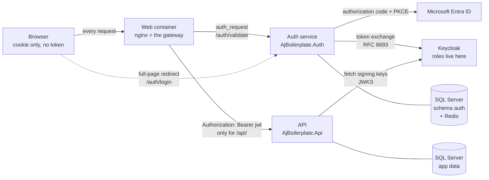
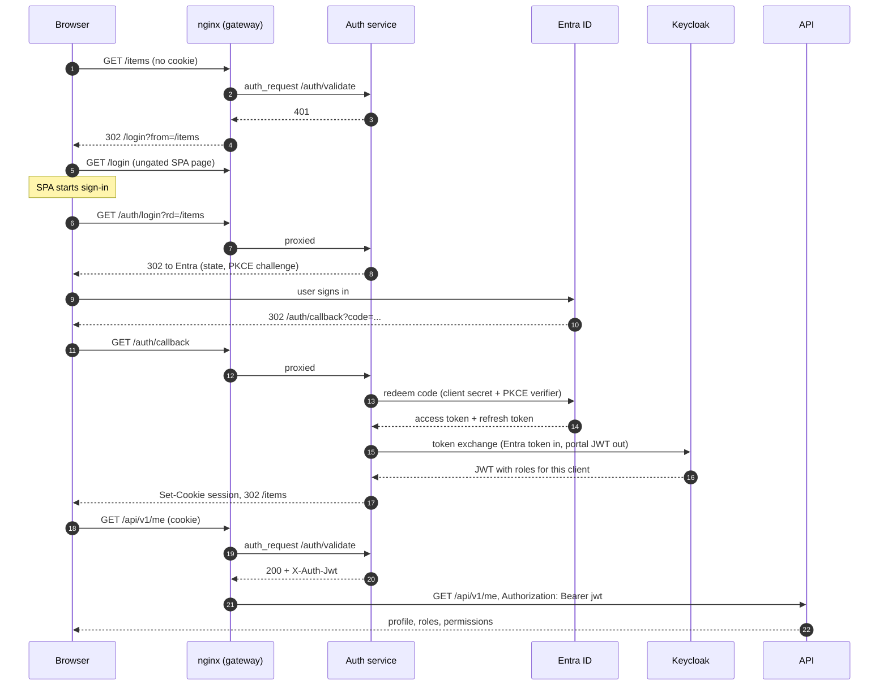

# Authentication and authorisation

How a user signs in, how the API knows who they are, and where to change it. Read this page
first; the other three go deeper.

| Document | Read it when |
|---|---|
| **This page** | You are new and want the picture |
| [setup.md](setup.md) | You are configuring sign-in: locally, with a real Entra ID tenant, or inside USP. It also has the config reference and "add a role". |
| [troubleshooting.md](troubleshooting.md) | A sign-in, a 401, a 403 or a 503 is not doing what you expect |
| [gateway-contract.md](gateway-contract.md) | You are changing behaviour. This is the exact contract the four parts share. |
| [ADR-0012](../adr/0012-gateway-session-auth.md) | You want to know **why** it is built this way |

## The idea in one paragraph

**The browser never holds a token.** After sign-in it holds one opaque, `HttpOnly` session cookie.
Every request goes through the web container's nginx, which asks the **Auth service** "is this
cookie a live session?". The Auth service answers with a **Keycloak JWT**, and nginx forwards the
request to the **API** as `Authorization: Bearer <jwt>`. The API validates the JWT like any other
bearer token. Sign-in is a server-side OAuth flow against **Microsoft Entra ID**; the Entra token
is exchanged at **Keycloak** for a JWT minted for this application, carrying its roles.

- **Authentication (who are you?)** is Entra ID, run by the Auth service.
- **Authorisation (what may you do?)** is Keycloak roles, enforced by the API.

## Who does what

| Part | Where it lives | Its one job |
|---|---|---|
| **Web gateway** | `src/frontend/docker/nginx/` | Gate `/` and `/api/`, inject the JWT, hide `/auth/validate`, turn 401/403/5xx into the right page |
| **Auth service** | `src/backend/src/AjBoilerplate.Auth/` | Sign users in, keep sessions, refresh tokens, answer `/auth/validate` |
| **API** | `src/backend/src/AjBoilerplate.Api/Identity/` | Validate the JWT, map roles to policies, serve `/api/v1/me` |
| **SPA** | `src/frontend/libs/auth/` | Start sign-in, learn the user from `/api/v1/me`, react to role changes |
| **Keycloak** | yours (bundled locally) | Hold roles; mint the JWT for this application's client |
| **Entra ID** | yours (simulated locally) | Prove who the person is |

## A sign-in, step by step

After that, the Auth service quietly refreshes the JWT (using the Entra refresh token) shortly
before it expires. A session lasts at most **12 hours from sign-in** and ends after **8 hours of
inactivity**.

## The five rules that matter most

1. **The browser holds no token.** Never store one, never add a browser-side OIDC client.
2. **An infrastructure fault never signs anyone out.** Keycloak or Redis being down gives a 503,
   not a login redirect.
3. **Only a `401` becomes a login redirect.** A 403 ("you may not") and a 503 ("we cannot tell")
   never do.
4. **The server decides, the UI only hints.** Hiding a button is not a permission check; every
   endpoint declares a policy.
5. **No secrets in files.** They arrive as environment variables from a secrets provider.

The full list is the [contract's invariants](gateway-contract.md#invariants-never-break-these).

## Two switches

| Switch | Values | Meaning |
|---|---|---|
| `AUTH_PROVIDER` (web container) | `embedded` (default), `usp` | `embedded`: you run the Auth service and the web container is the gateway. `usp`: you are inside the Al Jazeera USP platform; USP's shared gateway and auth-backend do the job and **you do not deploy the Auth service**. The web container then serves static files only. |
| `AUTH_MODE` (web container) | `gateway` (default), `dev` | `dev` shows a role picker and contacts no identity provider. **UI work and demos only**: no request carries a credential, so the API rejects every real call. |

The API has no matching switch. It validates Keycloak JWTs in every case.

## Seats and permissions

- **Seats** are roles with a hierarchy: `admin` > `editor` > `viewer`.
- **Permissions** are separate grants shaped `resource:action`: `items:read`, `items:write`,
  `admin:manage` ship as examples.
- A policy is satisfied by **a seat or a permission**.
- `GET /api/v1/me` returns the user's roles, capability flags and permissions. It is the only way
  the SPA learns who the user is.

Adding either is a short checklist: [setup, section 4](setup.md#4-roles-and-permissions-end-to-end).

## What this repository does and does not prove

| Covered | Not covered here |
|---|---|
| The whole flow runs locally with `docker compose up`, with a bundled Keycloak standing in for Entra ID | A real Entra ID tenant, and a Keycloak that exchanges an **external** (Entra) token |
| Unit and endpoint tests for the Auth service and API identity layer; architecture tests that keep the Auth service independent of the API | Deploying the Auth service, the web container or Keycloak to GCP or Azure. `infra/` provisions the API, its database, Redis and secrets only. |

## Where the code is

| Looking for | File |
|---|---|
| nginx gateway profiles | `src/frontend/docker/nginx/{embedded,usp,dev}.conf.template`, chosen by `docker/16-nginx-profile.sh` |
| Sign-in, sessions, refresh | `src/backend/src/AjBoilerplate.Auth/Sessions/` |
| Auth service configuration | `src/backend/src/AjBoilerplate.Auth/Configuration/AuthOptions.cs` |
| JWT validation, policies | `src/backend/src/AjBoilerplate.Api/Identity/AuthenticationSetup.cs` |
| Seats and permissions | `src/backend/src/AjBoilerplate.Application/Identity/` |
| Sign-in log | `src/backend/src/AjBoilerplate.Api/Infrastructure/SignInRecordingMiddleware.cs` |
| SPA sign-in and watchers | `src/frontend/libs/auth/`, `src/frontend/libs/shell/src/lib/role-change/` |
| Local Keycloak realm | `infra/keycloak/realm-aj-boilerplate.json` |
